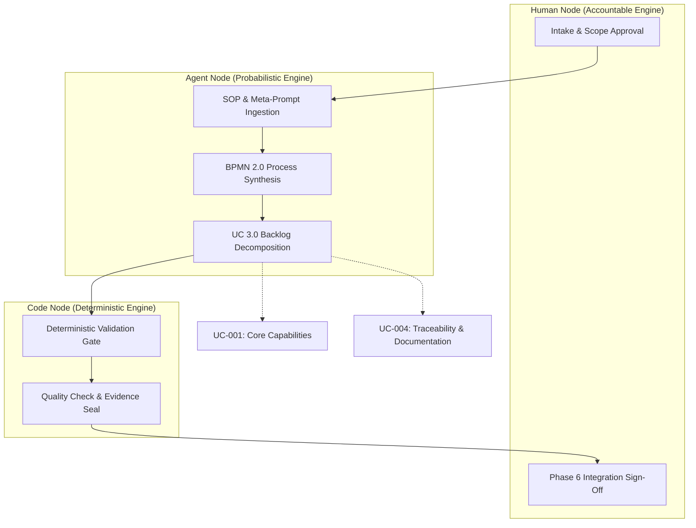
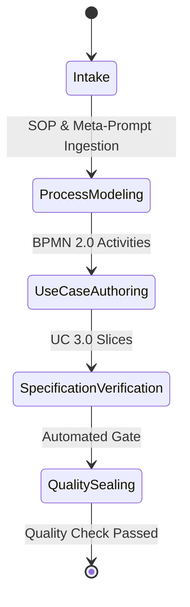

# BPMN 2.0 Process Workflows & FSM

> Upstream Hierarchy: SOP & Meta-Prompts ──► BPMN 2.0 ──► UC 3.0
> Source hash: 9efa86f147e4b64e16977bcab592a062076d7c2839a18adb055837809980f5ab

## 3-Pillar Swimlane Process Flow

## State Lifecycle & Invariants

